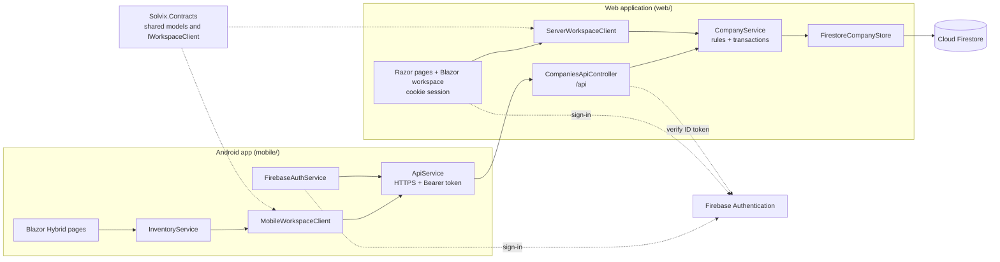

<div align="center">
  
  <h1>Solvix StockFlow</h1>
  <p><strong>Know what’s in stock. Know what moves next.</strong></p>
  <p>A multi-company inventory platform: an Android warehouse app and a web workspace, both backed by one Firebase-secured ASP.NET API.</p>

  <a href="https://github.com/zymasystems/Solvix-StockFlow/actions/workflows/ci.yml">
    
  </a>
  <a href="https://github.com/zymasystems/Solvix-StockFlow/actions/workflows/mobile-ci.yml">
    
  </a>
  
  
  
  
</div>

---

## Overview

Solvix StockFlow is about two things: knowing what is in stock, and keeping a trustworthy record of every change to it. Stock is tracked per company and per warehouse, and every quantity change goes through an approval flow and is written to an immutable movement ledger.

The repository holds two clients that share one backend:

- **Web application (`web/`)** is the ASP.NET Core backend and the browser workspace. It exposes the authenticated JSON API that both clients use, and serves a website where admins and staff manage inventory, receiving, dispatch, transfers, audits and company operations.
- **Android app (`mobile/`, "Solvix SIMS")** is the warehouse-floor experience, built with .NET MAUI and Blazor Hybrid. It signs in with Firebase, talks to the same API over HTTPS, and walks a team through receiving, dispatch, warehouse transfers and stock audits with scanning and approval gates.

Both sign in with the same Firebase project, both work inside a company workspace, and neither touches Firestore directly. Both are written in C# on .NET 10. See [Tech stack](#tech-stack) for the side-by-side breakdown.

> **Current status:** mobile and web are connected through the shared backend. No live HTTPS host has been provisioned and no production Firebase configuration or data migration has been run from this repository, so you need your own Firebase project and a reachable HTTPS backend to run the full system. See [`docs/CONNECTED-SETUP.md`](docs/CONNECTED-SETUP.md).

## What’s inside

| Project | Role | Stack | Data |
| --- | --- | --- | --- |
| [`web/`](web/) | Website, Blazor workspace and the JSON API used by both clients | ASP.NET Core (.NET 10), Razor, Blazor Server, Bootstrap, Firebase Authentication, Cloud Firestore | Cloud Firestore, accessed only from here |
| [`mobile/`](mobile/) | Android warehouse app (Solvix SIMS) | .NET MAUI (.NET 10), Blazor Hybrid, C#, Tailwind CSS | None stored locally; loaded from the API |
| [`shared/Solvix.Contracts/`](shared/Solvix.Contracts/) | Request and response models and the client interface shared by mobile and web | .NET 10 class library | None |
| [`shared/Solvix.Workspace/`](shared/Solvix.Workspace/) | The website’s workspace UI | Razor class library, Blazor Server components | None |
| [`tools/Solvix.Migrate/`](tools/Solvix.Migrate/) | Dry-run-first importer for legacy global data | .NET 10 console app | Firestore |
| [`web.tests/`](web.tests/) | Tests for the web services, controllers and validation | .NET 10, xUnit v3, Moq | None |
| [`mobile-tests/`](mobile-tests/) | Tests for mobile authentication, API and session code | .NET 10, xUnit v3 | None |
| [`connected.tests/`](connected.tests/) | Tenant isolation, HTTP and transactional workflow tests | .NET 10, xUnit, ASP.NET Core test host, Firestore emulator | Firestore emulator |
| [`.github/workflows/`](.github/workflows/) | CI for the backend and for the mobile app | GitHub Actions | None |

## Tech stack

| | Mobile (`mobile/`) | Web (`web/`) |
| --- | --- | --- |
| **Platform** | Android 6.0+ (API 23), `net10.0-android` | Server app on `net10.0`, runs on Kestrel; Docker image provided |
| **Framework** | .NET MAUI 10.0.20 | ASP.NET Core with MVC and Blazor Server |
| **Language** | C# (Razor components) | C# (Razor views and components) and JavaScript |
| **UI layer** | Blazor Hybrid: Razor components rendered in a BlazorWebView, with bottom-tab navigation | Server-rendered Razor pages for the landing page and sign-in, plus an interactive Blazor Server workspace from `Solvix.Workspace` |
| **Styling** | Tailwind CSS 3.4 compiled to `wwwroot/css/app.css`, Inter and Plus Jakarta Sans fonts, Material Symbols icons | Bootstrap 5.3.3 plus custom CSS for the site, landing page, login and dashboard |
| **Client scripting** | JavaScript interop inside the web view | JavaScript, jQuery with jQuery Validation, and the Firebase JS SDK 13.0.0 (app and auth) |
| **Authentication** | Firebase email and password through the Firebase REST API; refresh token in platform SecureStorage, ID token kept in memory | Firebase sign-in in the browser (email and password, Google, Microsoft), then a secure cookie session; Firebase Admin SDK verifies tokens |
| **API access** | `ApiService` over HTTPS with bearer tokens | Serves `/api` and verifies bearer tokens; the website calls the same service in-process |
| **Data** | No authoritative local data; everything is loaded from the API | Cloud Firestore through `Google.Cloud.Firestore` 4.5.0, behind `FirebaseAdmin` 3.7.0 credentials |
| **Shared code** | `Solvix.Contracts` | `Solvix.Contracts` and `Solvix.Workspace` |
| **Device features** | Camera barcode scanning through the web view camera API and `BarcodeDetector` where supported, with manual code entry as a fallback; camera, vibrate, internet and network-state permissions | Runs in the browser |
| **Tests** | xUnit v3 3.2.2, Microsoft.NET.Test.Sdk 18.0.1 (`mobile-tests/`) | xUnit v3 3.2.2 and Moq 4.20.72 (`web.tests/`); xUnit 2.9.3 with `Microsoft.AspNetCore.Mvc.Testing` 10.0.0 (`connected.tests/`) |
| **CI** | GitHub Actions: UI guard, tests, then a signed Android APK | GitHub Actions: tests against a Firestore emulator and a migration tool build |
| **To build or run** | .NET 10 SDK, MAUI Android workload, Android SDK, JDK 17 or newer, emulator or device, and an HTTPS backend URL; Node only to rebuild Tailwind CSS | .NET 10 SDK, a Firebase project with Authentication and Firestore, and Google credentials for the server |

Application ID for the Android app: `co.za.zyma.solvixsims`.

## How it fits together



Firestore is reachable only through the backend. The shipped `firestore.rules.connected` denies all direct browser and mobile access, so the API is the single authorization boundary and the approval ledger cannot be bypassed from a client.

## Companies, roles and access

Inventory belongs to a **company**, and access comes from **company membership**, never from a role sent by the client.

1. A person registers with Firebase on the website or in the app and signs in.
2. They either **create a company**, which makes them administrator of that company only, or **join** an existing one with its company ID, which creates a *Pending* membership.
3. A company administrator reviews the request, sets the role and assigns warehouses, then activates the member under Operations.

Every write re-reads the member’s active membership and warehouse access inside its transaction.

| Capability | Staff | Admin |
| --- | :---: | :---: |
| See company data for assigned warehouses | ✓ | All warehouses |
| Create products, receipts and dispatches; pick and verify items; submit audits | ✓ | ✓ |
| Approve or reject receipts, staged dispatches, outbound requests and audits | – | ✓ |
| Adjust or delete stock directly | – | ✓ |
| Archive products | – | ✓ |
| Manage warehouses, suppliers and company branding | – | ✓ |
| Review members, set roles, assign warehouses, add employees | – | ✓ |

An administrator cannot remove their own administrator access. The older global `users/{uid}` role and status are kept only for legacy profile compatibility and grant no access to any company.

## Operations workflows

Stock changes only at the final approval step of each flow, and rejection never changes stock.

- **Receiving:** Pending → arrival confirmed → barcode or SKU verified → admin approval → stock added once.
- **Dispatch:** Draft → all lines picked → Staged → admin stage approval → Outbound pending → outbound verified → admin final approval → Posted. Stock is rechecked and deducted atomically only at final approval.
- **Warehouse transfer:** final outbound approval creates the destination receipt. Destination stock is added only after arrival, verification and receipt approval. If a destination receipt is rejected the transfer becomes an *Exception*, and an administrator must reconcile it. Stock is not silently put back at the source.
- **Audits:** every count records the stock version it saw. Approval refuses a changed version, so a recount is required instead of overwriting movements that happened in between.

```mermaid
flowchart LR
    A[Create dispatch] --> B[Pick and verify]
    B --> C[Stage for review]
    C --> D[Approve staged dispatch]
    D --> E[Verify outbound]
    E --> F[Approve outbound]
    F --> G[Reduce source stock]
    G --> H[Create destination receipt]
    H --> I[Confirm arrival]
    I --> J[Verify inbound]
    J --> K[Approve receipt]
    K --> L[Add destination stock]
```



### Data integrity

- Writes are Firestore transactions that update stock and append an immutable movement record together.
- Every command carries a stable `RequestId`. Resending the same body returns the original result, and reusing an ID with different data returns `409`.
- SKUs and barcodes are unique within a company. Low stock is `OnHand <= MinStock`.
- Products and warehouses can only be archived when no stock or pending work remains, which preserves their history.
- Costs are decimal with up to two fractional digits and quantities are whole units. Selling price, currency conversion, taxes and invoicing are not implemented.

## Web application

- **Website:** a landing page, sign-in and registration, then a company workspace with Inventory, Receiving, Dispatch, Transfers, Audits, Movements and Operations sections. Older paths such as `/Dashboard`, `/Products`, `/Reports` and `/Users` open the matching workspace section.
- **Sessions:** the browser signs in with Firebase and posts a freshly issued ID token to the server, which verifies it and sets a `__Host-Solvix.Auth` cookie (HttpOnly, Secure, SameSite=Lax, 60-minute session without sliding renewal). Account forms use antiforgery tokens. The workspace hub requires an authenticated identity.
- **API:** all `/api` calls need `Authorization: Bearer <Firebase ID token>`. Browser cookies never authenticate API calls.
- **Errors:** failures return consistent ProblemDetails responses without provider exception details. HSTS is on outside Development, and forwarded headers are trusted only from configured proxy IPs.
- **Retired endpoints:** the original global product, supplier, sales, stock, dashboard, report and user controllers are deliberately not discoverable. Company routes are the only inventory write path, so old and new clients cannot be deployed side by side without a coordinated cutover.

### JSON API

| Method and route | Purpose |
| --- | --- |
| `GET /api/me/companies` | The caller’s memberships, including pending requests |
| `POST /api/companies` | Create a company with the caller as its owner |
| `POST /api/companies/{id}/join` | Request access to an existing company |
| `GET /api/companies/{id}/workspace?warehouseId=&search=` | The caller’s permitted snapshot of company data |
| `GET /api/companies/{id}/barcode/{code}?warehouseId=` | Exact SKU or barcode lookup |
| `GET /api/companies/{id}/resources/{resource}?warehouseId=&pageSize=&cursor=` | A page of `products`, `warehouses`, `suppliers`, `members`, `receipts`, `dispatches`, `transfers`, `audits` or `movements` (page size 1 to 100) |
| `POST /api/companies/{id}/commands/{command}` | A validated, idempotent transaction (for example `receipt.approve`, `dispatch.create`, `stock.adjust`) |
| `POST /api/companies/{id}/employees` | Admin adds an already registered Firebase account to the company |
| `GET` / `PUT /api/me/profile` | Name and profile picture |
| `GET /health/live` | Liveness check only, not a Firebase readiness check |

A legacy `/api/profile` route (`GET`, `POST`, `PUT`) is also still available.

### Run the web app

**Requirements**

- .NET 10 SDK
- A Firebase project with **Email/Password** sign-in and Cloud Firestore enabled (add Google or Microsoft providers if you want those buttons to work), and your site domain added to Firebase authorized domains
- Google credentials for the server, kept outside the repository

**Configuration**

| Setting | Purpose |
| --- | --- |
| `Firebase:ProjectId` | Firebase project to use (required) |
| `Firebase:Web:ApiKey`, `AuthDomain`, `AppId` | Public web configuration for the browser sign-in pages. Replace the `YOUR_FIREBASE_WEB_API_KEY` placeholder |
| `Firebase:ServiceAccountPath` | Optional path to a service-account JSON file. If it is empty the server uses Application Default Credentials |
| `GOOGLE_APPLICATION_CREDENTIALS` | Alternative way to point local runs at a service-account file |
| `AllowedHosts` | Currently `localhost`; widen it for any other host |
| `Hosting:KnownProxies:0` ... | Trusted reverse-proxy IPs when hosting behind one |

On a managed Google host, attach a service account with the needed Firestore and Firebase Auth permissions. Locally, use user secrets so no key lands in a committed file:

```bash
dotnet user-secrets init --project web/Solvix.Web.csproj
dotnet user-secrets set "Firebase:ServiceAccountPath" "/secure/path/service-account.json" --project web/Solvix.Web.csproj
```

**Start the site**

```bash
dotnet run --project web/Solvix.Web.csproj --launch-profile https
```

The site listens on `https://localhost:7202` and `http://localhost:5118`. Open `/Account/Register`, create an account, sign in, then create your company and add warehouses under Operations. Never commit a service-account key, `.env` file or other credentials.

### Run with Docker

`web/Dockerfile` builds from the repository root and listens on port 8080:

```bash
docker build -f web/Dockerfile -t solvix-web .
```

Run it behind a TLS reverse proxy with WebSockets enabled, because the workspace uses Blazor Server. Provide `Firebase__ProjectId`, the public Firebase web settings, `AllowedHosts`, trusted proxy IPs and server credentials through host configuration, and persist ASP.NET data-protection keys so cookies survive restarts.

## Android app

### Capabilities

- **Company workspaces** — sign in, create or join a company, and switch between companies and warehouses. Switching discards stale data.
- **Warehouse-scoped inventory** — each warehouse has its own stock, valuation and low-stock view.
- **Receiving** — record deliveries, confirm arrivals, verify item barcodes, then submit for approval.
- **Dispatch** — build a pick list, verify picked items, stage it for review, and verify the approved outbound before stock leaves.
- **Warehouse transfers** — an approved outbound creates a receipt at the destination, and stock is added only after arrival, verification and approval.
- **Stock control** — product details, adjustments, stock audits and removal of eligible stock records.
- **Visibility** — analytics and a movement feed for the active company and warehouse.
- **Operations tools** — warehouses, suppliers, employee assignments, profile, and notification preferences.

### How it connects

- The pages and models are the original mobile design. `InventoryService` adapts them to asynchronous calls through `MobileWorkspaceClient`, `ApiService` and the shared `IWorkspaceClient` contract.
- Only the refresh token of a remembered session is stored in platform SecureStorage. ID tokens stay in memory and are refreshed before expiry. The app starts signed out and verifies the backend identity before showing protected pages.
- `GET` requests that fail on the network, or with 429, 502, 503 or 504, are retried up to three attempts in total. Writes are never retried automatically, so resubmit an uncertain write with the same unchanged body and `RequestId`.
- A `401` clears authentication. A `403` means access was denied and does not sign the user out. If the app is offline it shows an error instead of pretending an operation succeeded.
- Certificate validation is never bypassed. A missing, malformed, placeholder or non-HTTPS backend address produces a handled configuration message instead of a crash.
- Notification preferences and the achievements screen are kept as designed. No push delivery backend is included.

### Configure

1. Put the same public Firebase project ID and web API key in `mobile/authsettings.json`.
2. Set `Solvix:Api:BaseUrl` in `mobile/appsettings.json` to your backend’s **HTTPS** address with a trailing slash. A phone or emulator cannot reach your computer through `localhost`, so use a reachable HTTPS host or tunnel with a trusted certificate.
3. Rebuild, because both files are packaged into the app.

The Firebase web API key identifies the project and is safe to ship. Never put a service-account or Admin SDK key in the app.

### Build and run

**Requirements**

- .NET 10 SDK
- .NET MAUI Android workload
- Android SDK and platform tools
- JDK 17 or newer (CI uses 17, and the setup guide recommends 21)
- An Android emulator or a device with USB debugging enabled

Install the MAUI workload if it is not already available:

```bash
dotnet workload install maui-android
```

Restore and build from the repository root. Restore deliberately does not force the Android target framework, so the shared libraries restore for their own target:

```bash
dotnet restore mobile/Solvix.Sims.csproj
dotnet build mobile/Solvix.Sims.csproj -f net10.0-android
```

To launch on a connected device or running emulator:

```bash
dotnet build mobile/Solvix.Sims.csproj -t:Run -f net10.0-android
```

You can also open `mobile/Solvix.Sims.csproj` in Visual Studio, set it as the startup project, select an Android emulator or USB-connected device, and run it. The project targets Android only.

If the app closes during startup, run it with the debugger attached and enable breaking on thrown Common Language Runtime exceptions. The first exception and its stack trace usually point at the cause, and a successful build alone does not prove the app launches on a given device. Redact tokens, passwords and service-account JSON before sharing logs.

### Styling

The app UI uses Tailwind CSS, compiled to `mobile/wwwroot/css/app.css`. The compiled file is committed, so you only need Node when you change styles:

```bash
cd mobile/tools/tailwind
npm install
npm run build   # or: npm run watch
```

`tools/verify-mobile-ui.py` guards the original mobile design. It compares the visible markup of the supplied components and assets with `mobile/ui-baseline.json`, so handler code can change but visual markup cannot change by accident. Updating the baseline is a deliberate design decision, and the script never rewrites it.

## Tests and CI

### Run the tests

```bash
dotnet test web.tests/Solvix.Web.Tests.csproj -m:1
dotnet test mobile-tests/Solvix.Sims.Tests.csproj -m:1
dotnet test connected.tests/Solvix.Connected.Tests.csproj -m:1
```

| Suite | What it covers |
| --- | --- |
| `web.tests/` (web) | Web services, controllers and validation: current-user resolution, products, inventory and dashboard logic, user management and movement validation |
| `connected.tests/` (web and shared) | Company and warehouse isolation, HTTP tests with two independent clients against one store, transactional workflow tests, and workspace rendering |
| `mobile-tests/` (mobile) | The production Firebase authentication, API client, settings and session code, tested without a device and with a mocked Firebase service |

Tests in `connected.tests/` that need a database are skipped unless `FIRESTORE_EMULATOR_HOST` points at a Firestore emulator. HTTP tests use a test-only identity handler, and production Firebase verification is unchanged.

### Web and backend CI

**Connected backend checks** (`ci.yml`) runs on every push and pull request. It starts an isolated Firestore emulator at `127.0.0.1:8089`, then runs the `web.tests` and `connected.tests` suites and builds the migration tool, uploading the test results.

### Mobile CI

**Mobile app checks** (`mobile-ci.yml`) runs when `mobile/`, `mobile-tests/`, `shared/`, the UI guard script or the workflow changes, on pull requests, and manually from the **Actions** tab. It verifies the original UI, runs the mobile tests, and builds a signed Release APK. The APK is uploaded as the artifact **Solvix Sims APK**, containing **`Solvix Sims.apk`**.

Release APKs use one persistent signing key so Android accepts future builds as updates. Add these repository Actions secrets before the workflow can package an APK:

- `ANDROID_RELEASE_KEYSTORE_BASE64`: the Base64 encoding of the keystore
- `ANDROID_RELEASE_KEYSTORE_PASSWORD`: the keystore password, which the workflow also uses as the key password

The keystore must contain a key with the alias `solvix-release`. The workflow fails clearly if a secret is missing, including on pull requests from forks, writes the keystore only to the runner’s temporary folder, and deletes it afterwards. Keep a secure backup of the key and never commit it.

A passing build does not verify camera permissions or device SecureStorage behaviour. Before a release, smoke-test on a real device against a staging backend: two accounts, company creation and join approval, warehouse assignment, receipt rejection and approval, transfer verification, concurrent outbound attempts, profile and email verification, going offline and retrying, sign-out, and company switching.

## Migrating legacy data

Data created by the earlier single-business version lives in global Firestore collections. `tools/Solvix.Migrate` imports it into a company workspace. It is a **dry run unless you pass `--apply`**, and it refuses to guess a company or reinterpret a selling price as a cost.

1. Back up or export Firestore, and stop any legacy writers.
2. Create the target company and warehouse in the new UI, and confirm who owns them and whether the legacy `price` means cost.
3. Run the dry run, fix any duplicate SKUs, invalid prices, negative counts or conflicts, then run it again with `--apply`:

```bash
dotnet run --project tools/Solvix.Migrate -- --project YOUR_PROJECT --company COMPANY_ID --warehouse WAREHOUSE_ID --owner-uid FIREBASE_UID --legacy-price-is-cost
```

The importer preserves product and supplier IDs, creates the SKU index and opening stock with one opening movement per product, and archives the legacy `products`, `suppliers`, `sales` and `adjustments` snapshots without replaying history. Per-document fingerprints make retries safe and detect changed sources. An interrupted import can resume, but it is not a single all-or-nothing transaction. Each source collection is limited to 1,000 rows.

Deploy `firestore.rules.connected` only after reviewing any unrelated rules in your project. Broad legacy client-write rules would bypass the approval ledger and must be closed during cutover.

## Known limits

- A collection is bounded to 1,000 documents, and the API fails explicitly beyond that instead of showing incomplete totals. Resource endpoints paginate with stable cursors but read a bounded, authorized workspace, so they are not scalable indexed queries yet.
- Dispatches and audits support up to 40 distinct lines.
- Profile pictures accept private PNG or JPEG uploads up to 200 KB, or HTTPS URLs. Display details are stored in bounded `UiJson` fields of at most 400 KB, and large warehouse attachments need dedicated file storage.
- The dashboard shows cost valuation, low stock and daily movement counts. Forecasting is not included.
- Email re-authentication currently covers password accounts. Federated accounts need provider-specific re-authentication before that flow is added.

## Repository map

```text
.
├── .github/workflows/
│   ├── ci.yml                        # Backend tests against a Firestore emulator
│   └── mobile-ci.yml                 # Mobile UI guard, tests and signed APK
├── docs/CONNECTED-SETUP.md           # Full setup, data model and API guide
├── firestore.rules.connected         # Deny-all rules for direct client access
├── Solvix.StockFlow.slnx             # Solution containing every project
├── mobile/                           # MAUI Android app (Solvix SIMS)
│   ├── Components/                   # Blazor pages, layouts and shared components
│   ├── Models/                       # Inventory and workflow models
│   ├── Services/                     # API client, auth, session and inventory adapter
│   ├── Platforms/Android/            # Android manifest and entry points
│   ├── Resources/                    # App icon and platform resources
│   ├── wwwroot/                      # Compiled CSS, fonts, images and scripts
│   ├── tools/tailwind/               # Tailwind CSS build tooling
│   ├── appsettings.json              # Backend base URL
│   ├── authsettings.json             # Public Firebase project settings
│   └── ui-baseline.json              # Baseline for the UI guard
├── web/                              # ASP.NET Core backend and website
│   ├── ApiControllers/               # JSON API under /api
│   ├── Connected/                    # Company rules, transactions and Firestore store
│   ├── Controllers/                  # Home, account and workspace controllers
│   ├── Authentication/               # Firebase token verification and bearer handler
│   ├── Authorization/                # Authorization policies
│   ├── Services/ and Repositories/   # Legacy services and Firestore access
│   ├── Views/ and wwwroot/           # Razor pages, CSS, JavaScript and libraries
│   └── Dockerfile                    # Container build, run from the repo root
├── shared/
│   ├── Solvix.Contracts/             # Shared models and IWorkspaceClient
│   └── Solvix.Workspace/             # Website workspace UI (Blazor)
├── tools/
│   ├── Solvix.Migrate/               # Legacy data importer
│   └── verify-mobile-ui.py           # Mobile design guard
├── web.tests/                        # Web service and controller tests
├── mobile-tests/                     # Mobile authentication and API tests
└── connected.tests/                  # Isolation, HTTP and transaction tests
```

## Contributing

1. Create a branch for your change.
2. **Mobile changes:** run `mobile-tests`, build the Android target, and run `python3 tools/verify-mobile-ui.py` if you touched any page markup.
3. **Web and backend changes:** run `web.tests` and `connected.tests`. For anything that touches transactions, run the Firestore emulator and set `FIRESTORE_EMULATOR_HOST`.
4. **Shared contract changes:** both clients depend on `shared/`, so test and build both sides.
5. Keep service-account keys, `authsettings.local.json`, `.env` files and keystores out of Git.
6. Open a pull request. Backend checks run on every push and pull request, and mobile checks run when mobile or shared code changes.

---

<div align="center"><sub>Built by Zyma Systems · Solvix StockFlow</sub></div>
