<div align="center">
  
  <h1>Solvix StockFlow</h1>
  <p><strong>Know what’s in stock. Know what moves next.</strong></p>
  <p>A warehouse operations platform for inventory, receiving, dispatch, and stock movement.</p>

  <a href="https://github.com/zymasystems/Solvix-StockFlow-Website/actions/workflows/mobile-ci.yml">
    
  </a>
  
  
</div>

---

Solvix StockFlow brings day-to-day warehouse work into one clear flow: track stock by location, verify goods as they move, and keep a usable record of every approved change.

## What’s inside

| Project | What it does | Stack |
| --- | --- | --- |
| [`mobile/`](mobile/) | Android warehouse app for inventory and operations | .NET MAUI, Blazor Hybrid, C# |
| [`mobile-tests/`](mobile-tests/) | Automated inventory and workflow tests | .NET 10, xUnit |
| [`web/`](web/) | Separate web application and admin/staff experience | PHP, MySQL, Firebase |

The mobile and web projects are maintained separately in this repository. See [`web/README.md`](web/README.md) for the website’s setup notes.

## Mobile capabilities

- **Warehouse-scoped inventory** — each company’s warehouses have their own product counts and stock valuation.
- **Receiving** — record deliveries, confirm arrivals, verify item barcodes, then approve receipts.
- **Dispatch** — build a pick list, verify picked items, stage it for review, and approve the resulting outbound before stock leaves the source warehouse.
- **Warehouse transfers** — an approved outbound transfer creates an inbound at its destination. Destination stock is added only after arrival, item verification, and approval.
- **Stock control** — inspect product details, adjust counts, run stock audits, and remove eligible stock records.
- **Visibility** — review warehouse analytics and a movement feed filtered to the active company and warehouse.
- **Operations tools** — manage warehouses, suppliers, employee assignments, profile details, and notification preferences.

Rejected inbound receipts do not increase on-hand stock. Approval gates protect the ledger at each point in the receiving and dispatch workflows.

## Operations workflow

### Warehouse transfer

```mermaid
flowchart LR
    A[Create dispatch] --> B[Pick and verify]
    B --> C[Stage for review]
    C --> D[Approve staged dispatch]
    D --> E[Verify outbound]
    E --> F[Approve outbound]
    F --> G[Reduce source stock]
    G --> H[Confirm destination arrival]
    H --> I[Verify inbound]
    I --> J[Approve receipt]
    J --> K[Add destination stock]
```



Supplier receipts follow the receiving leg of the same control flow: record the delivery, confirm arrival when required, verify the item, and approve the receipt before stock is added.

## Connecting the mobile app to the web API

The mobile app is fully functional offline (app-local ledger in `mobile/Services/InventoryService.cs`). To connect it to the
Solvix web API (`web/Solvix.Web.csproj`, ASP.NET Core, Firebase bearer auth, JSON endpoints under `/api/*`):

1. Open `mobile/appsettings.json` and set `Solvix.Api.BaseUrl` to the web API host:
   - Android emulator: `http://10.0.2.2:5118/` (debug default — emulator reaches the host machine on `10.0.2.2`)
   - Physical device on the same Wi-Fi: `http://<PC-IP>:5118/`
   - Published API: `https://api.<your-domain>/`
2. Inject `ApiService` into any page or component and call `GetAsync<T>`, `PostAsync<TBody, TResult>`,
   `PutAsync<TBody, TResult>`, or `DeleteAsync`. Paths are relative to the base URL, e.g. `api/products`.
3. Call `await ApiService.SetAuthTokenAsync(idToken)` with a Firebase ID token so authorized endpoints
   receive `Authorization: Bearer <token>`. Clear it with `ClearAuthTokenAsync()` on sign-out.
4. Inject `ConnectionService` to react to online/offline changes (`IsConnected`, `Changed` event,
   `WaitForConnectionAsync()`). A `ConnectionStatus` component is available under `Components/Shared`.

Cleartext HTTP is permitted for emulator `10.0.2.2` / `localhost` in debug builds via
`mobile/Platforms/Android/Resources/xml/network_security_config.xml`. Point the release build at an HTTPS host
and remove cleartext traffic before publishing.

## Get started: Android

### Requirements

- .NET 10 SDK
- .NET MAUI Android workload
- Android SDK and platform tools
- Java 17 (needed for Android builds)
- An Android emulator or a device with USB debugging enabled

Install the MAUI workload if it is not already available:

```bash
dotnet workload install maui-android
```

Restore and build from the repository root:

```bash
dotnet restore mobile/Solvix.Sims.csproj -p:TargetFramework=net10.0-android
dotnet build mobile/Solvix.Sims.csproj -f net10.0-android
```

To launch on a connected device or running emulator:

```bash
dotnet build mobile/Solvix.Sims.csproj -t:Run -f net10.0-android
```

You can also open `mobile/Solvix.Sims.csproj` in Visual Studio, select an Android emulator or USB-connected device, and run the app from the IDE.

## Tests and Android package

Run the mobile service and workflow tests locally:

```bash
dotnet test mobile-tests/Solvix.Sims.Tests.csproj --configuration Release
```

GitHub Actions runs those tests and builds the Android app when mobile code or its tests change. It also runs on pull requests and can be started manually from the **Actions** tab. The workflow uploads an installable APK artifact named **Solvix Sims APK**; inside it, the file is **`Solvix Sims.apk`**.

Release APKs use one persistent signing key so Android accepts future builds as updates. Before the workflow can package an APK, add the repository Actions secrets `ANDROID_RELEASE_KEYSTORE_BASE64` and `ANDROID_RELEASE_KEYSTORE_PASSWORD`. The local keystore lives in the ignored `.local-signing/` folder; keep a secure backup and never commit it.

The tests cover warehouse separation, inbound arrival and approval, rejected receipts, staged dispatch and outbound approval, warehouse transfers, stock deletion, and company sign-in. The Android build compiles the full MAUI app, including its pages and resources.

## Repository map

```text
.
├── .github/workflows/mobile-ci.yml   # Mobile tests and Android build
├── mobile/                           # MAUI Android app
│   ├── Components/Pages/             # App screens
│   ├── Models/                       # Inventory and workflow models
│   ├── Services/                     # App state and inventory operations
│   └── Resources/                    # App icon and platform resources
├── mobile-tests/                     # Inventory workflow test suite
└── web/                              # Separate PHP web application
```

## Implementation notes

The mobile app currently initializes its inventory ledger and sample company data in `InventoryService`; its warehouse stock is app-local and is not synchronized with the separate web project. The web app has its own PHP, MySQL, and Firebase configuration. Keep local credentials and environment files out of Git.

## Contributing

1. Create a branch for your change.
2. Run the mobile tests and build the Android target.
3. Open a pull request. Mobile changes are checked by the **Mobile app checks** workflow.

---

<div align="center"><sub>Built by Zyma Systems · Solvix StockFlow</sub></div>
