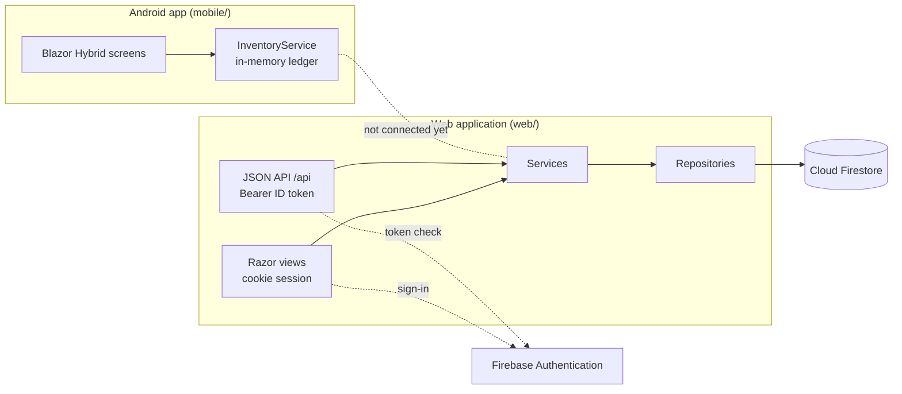

# Connected mobile and website implementation

See [setup, API contracts, migration and deployment](docs/CONNECTED-SETUP.md) for the shared Firebase backend and MAUI integration.

<div align="center">
  
  <h1>Solvix StockFlow</h1>
  <p><strong>Know what’s in stock. Know what moves next.</strong></p>
  <p>An inventory platform made of an Android warehouse app and a Firebase-backed web application with a JSON API.</p>

  <a href="https://github.com/zymasystems/Solvix-StockFlow/actions/workflows/mobile-ci.yml">
    
  </a>
  
  
  
  
</div>

---

## Overview

Solvix StockFlow is about two things: knowing what is in stock, and keeping a trustworthy record of every change to it. The repository holds two applications built for different jobs, plus the tests and CI around them.

- **Web application (`web/`)** is the shared system of record, built with ASP.NET Core MVC, Firebase Authentication and Cloud Firestore. Admin and staff sign in to manage the product catalogue, suppliers, sales and stock movements, and review a dashboard and inventory report. The same operations are available as a JSON API for other clients.
- **Android app (`mobile/`, "Solvix SIMS")** is the warehouse-floor experience, built with .NET MAUI and Blazor Hybrid. It walks a team through receiving, dispatch, warehouse transfers and stock audits, with scanning and approval gates at each step.

Both are written in C# on .NET 10. See [Tech stack](#tech-stack) for the full side-by-side breakdown.

> **Current status:** the two applications are independent. The Android app runs on seeded, app-local sample data, and the web app stores its data in Cloud Firestore. Nothing is synchronised between them yet.

## What’s inside

| Project | Role | Stack | Data |
| --- | --- | --- | --- |
| [`web/`](web/) | Website and JSON API for admin and staff | ASP.NET Core MVC (.NET 10), Razor, Bootstrap, Firebase Authentication, Cloud Firestore | Cloud Firestore |
| [`mobile/`](mobile/) | Android warehouse app (Solvix SIMS) | .NET MAUI (.NET 10), Blazor Hybrid, C#, Tailwind CSS | In-memory sample data, local to the app |
| [`mobile-tests/`](mobile-tests/) | Tests for the mobile inventory and workflow logic | .NET 10, xUnit | None |
| [`.github/workflows/`](.github/workflows/) | CI for the mobile app and tests | GitHub Actions | None |

## Tech stack

| | Mobile (`mobile/`) | Web (`web/`) |
| --- | --- | --- |
| **Platform** | Android 6.0+ (API 23) app, `net10.0-android` | Server app on `net10.0`, runs on Kestrel |
| **Framework** | .NET MAUI 10.0.20 | ASP.NET Core MVC |
| **Language** | C# (Razor components) | C# (Razor views) and JavaScript |
| **UI layer** | Blazor Hybrid: Razor components rendered in a BlazorWebView | Server-rendered Razor views, plus JSON API controllers under `/api` |
| **Styling** | Tailwind CSS 3.4 (compiled to `wwwroot/css/app.css`), Inter and Plus Jakarta Sans fonts, Material Symbols icons | Bootstrap 5.3.3 plus custom CSS for the site, landing page, login and dashboard |
| **Client scripting** | JavaScript interop inside the web view | JavaScript, jQuery with jQuery Validation, and the Firebase JS SDK 13.0.0 (app and auth) for browser sign-in |
| **Authentication** | Prototype sign-in against sample data (not real authentication) | Firebase Authentication ID tokens; cookie session for the website, bearer token for `/api` |
| **Data** | In-memory sample data held in `InventoryService` | Cloud Firestore through `Google.Cloud.Firestore` 4.5.0 |
| **Server SDKs** | None | `FirebaseAdmin` 3.7.0 for token verification |
| **Device features** | Camera barcode scanning through the web view’s camera API and `BarcodeDetector` where supported, with manual code entry as a fallback; camera, vibrate, internet and network-state permissions | Runs in the browser |
| **Tests** | xUnit 2.9.3 with Microsoft.NET.Test.Sdk 17.14.1 (`mobile-tests/`) | None yet |
| **CI** | GitHub Actions: tests, then a signed Android APK | None yet |
| **To build or run** | .NET 10 SDK, MAUI Android workload, Android SDK, Java 17, emulator or device; Node only to rebuild Tailwind CSS | .NET 10 SDK, a Firebase project and a service-account key |

Application ID for the Android app: `co.za.zyma.solvixsims`.

## How it fits together



## Web application

### What it does

- **Products** — catalogue with SKU, category, price, stock and minimum level. Status (In Stock, Low Stock, Out of Stock) is calculated from stock against the minimum.
- **Suppliers** — supplier directory with contact details and status.
- **Sales and stock out** — record a sale, return or transfer against a product. Sales and transfers reduce stock; returns add it back.
- **Stock adjustments** — add, subtract or set a product’s stock with a recorded reason, plus a paged history.
- **Dashboard and reports** — separate admin and staff dashboards showing totals, inventory value, low and out-of-stock products, and recent sales and adjustments, plus an inventory report.
- **User management** — admins review profiles, set the role (`admin` or `staff`) and activate or deactivate accounts.

### Roles and access

Anyone can register with Firebase, but a new profile waits for administrator approval and no website session is issued until an admin marks it **Active**. Roles are checked against the profile stored in Firestore on every request, never against a role sent by the client.

| Capability | Staff | Admin |
| --- | :---: | :---: |
| View dashboard, products, suppliers, sales, stock history and reports | ✓ | ✓ |
| Create and edit products, record sales, adjust stock | ✓ | ✓ |
| Create and edit suppliers | Website only | ✓ |
| Delete products | – | ✓ |
| Manage users | – | ✓ |

Supplier create and update are admin-only through the API but open to any active user on the website. Align the two if that is not intended.

### Authentication

- **Website:** the browser signs in with Firebase and posts the ID token to the server. The server verifies it, requires that the sign-in happened within the last five minutes, and issues the `__Host-Solvix.Auth` cookie (HttpOnly, Secure, SameSite=Lax, 60-minute session without sliding renewal). Account forms use antiforgery tokens.
- **API:** send `Authorization: Bearer <Firebase ID token>`. Routes under `/api` never fall back to the browser cookie.
- **Errors:** failures return consistent ProblemDetails responses that do not expose provider exception details. HSTS is enabled outside Development.

### JSON API

All routes require an active profile unless noted. List endpoints are cursor-paged with `pageSize` (default 50) and `cursor`.

| Route | Methods | Notes |
| --- | --- | --- |
| `/api/profile` | `GET`, `POST`, `PUT` | `POST` creates a profile for any verified Firebase identity; the profile still needs approval |
| `/api/dashboard` | `GET` | Totals, low-stock products, recent sales and adjustments |
| `/api/products` | `GET`, `GET {id}`, `POST`, `PUT {id}`, `DELETE {id}` | `DELETE` is admin-only |
| `/api/suppliers` | `GET`, `GET {id}`, `POST`, `PUT {id}` | `POST` and `PUT` are admin-only |
| `/api/sales` | `GET`, `POST` | `type` is `Sale`, `Return` or `Transfer` |
| `/api/stock-adjustments` | `GET`, `POST` | `type` is `Add`, `Subtract` or `Set` |
| `/api/reports/inventory` | `GET` | Inventory report with product rows |

### Stock integrity

- Sales and adjustments run inside a Firestore transaction: read the product, compute the new quantity, refuse anything below zero (`409`), then update stock and status and write the movement record together.
- Every write carries a client-supplied `requestId`. Retrying the same request returns the original result instead of applying it twice, and reusing an ID for a different operation returns `409`.
- The “performed by” field comes from the authenticated user, not from the request body.
- SKUs are kept unique through a reservation index in Firestore (`skuReservations`). `SkuIndexMaintenance.InitialiseAsync` builds that index for an existing catalogue. It is meant to be run as a trusted one-off with all writers stopped, never over HTTP, and it is not wired to a command yet.

### Run the web app

**Requirements**

- .NET 10 SDK
- A Firebase project with Authentication and Cloud Firestore enabled
- A Firebase service-account key file, kept outside the repository

**Configuration**

| Setting | Purpose |
| --- | --- |
| `Firebase:ProjectId` | Firebase project to use (required) |
| `Firebase:ServiceAccountPath` | Path to the service-account JSON file; the app refuses to start if the file is missing |
| `Firebase:Web:*` | Web API key, auth domain and app ID used by the browser sign-in pages |
| `Solvix:SingleBusinessMode` | Must be `true`. All users share one global set of Firestore collections |
| `AllowedHosts` | Currently `localhost`; widen it for any other host |

`appsettings.json` and `Properties/launchSettings.json` currently point at a service-account path on the original developer’s machine. Override the path locally with an environment variable instead of editing committed files:

```bash
# macOS / Linux
export Firebase__ServiceAccountPath="/secure/path/service-account.json"

# Windows PowerShell
$env:Firebase__ServiceAccountPath = "C:\secure\path\service-account.json"
```

**Start the site**

```bash
dotnet run --project web/Solvix.Web.csproj --launch-profile https
```

The site listens on `https://localhost:7202` and `http://localhost:5118`. Never commit the service-account file, `.env` files or other credentials.

## Android app

### Capabilities

- **Warehouse-scoped inventory** — each company’s warehouses have their own product counts and stock valuation.
- **Receiving** — record deliveries, confirm arrivals, verify item barcodes, then approve receipts.
- **Dispatch** — build a pick list, verify picked items, stage it for review, and approve the resulting outbound before stock leaves the source warehouse.
- **Warehouse transfers** — an approved outbound transfer creates an inbound at its destination. Destination stock is added only after arrival, item verification, and approval.
- **Stock control** — inspect product details, adjust counts, run stock audits, and remove eligible stock records.
- **Visibility** — review warehouse analytics and a movement feed filtered to the active company and warehouse.
- **Operations tools** — manage warehouses, suppliers, employee assignments, profile details, and notification preferences.

Rejected inbound receipts do not increase on-hand stock. Approval gates protect the ledger at each point in the receiving and dispatch workflows.

### Warehouse transfer workflow



```mermaid
flowchart LR
    A[Create dispatch] --> B[Pick and verify]
    B --> C[Stage for review]
    C --> D[Approve staged dispatch]
    D --> E[Verify outbound]
    E --> F[Approve outbound]
    F --> G[Reduce source stock]
    G --> H[Confirm destination arrival]
    H --> I[Verify inbound]
    I --> J[Approve receipt]
    J --> K[Add destination stock]
```

Supplier receipts follow the receiving leg of the same control flow: record the delivery, confirm arrival when required, verify the item, and approve the receipt before stock is added.

## Connecting the mobile app to the web API

The mobile app is fully functional offline (app-local ledger in `mobile/Services/InventoryService.cs`). To connect it to the
Solvix web API (`web/Solvix.Web.csproj`, ASP.NET Core, Firebase bearer auth, JSON endpoints under `/api/*`):

1. Open `mobile/appsettings.json` and set `Solvix.Api.BaseUrl` to the web API host:
   - Android emulator: `http://10.0.2.2:5118/` (debug default — emulator reaches the host machine on `10.0.2.2`)
   - Physical device on the same Wi-Fi: `http://<PC-IP>:5118/`
   - Published API: `https://api.<your-domain>/`
2. Inject `ApiService` into any page or component and call `GetAsync<T>`, `PostAsync<TBody, TResult>`,
   `PutAsync<TBody, TResult>`, or `DeleteAsync`. Paths are relative to the base URL, e.g. `api/products`.
3. Call `await ApiService.SetAuthTokenAsync(idToken)` with a Firebase ID token so authorized endpoints
   receive `Authorization: Bearer <token>`. Clear it with `ClearAuthTokenAsync()` on sign-out.
4. Inject `ConnectionService` to react to online/offline changes (`IsConnected`, `Changed` event,
   `WaitForConnectionAsync()`). A `ConnectionStatus` component is available under `Components/Shared`.

Cleartext HTTP is permitted for emulator `10.0.2.2` / `localhost` in debug builds via
`mobile/Platforms/Android/Resources/xml/network_security_config.xml`. Point the release build at an HTTPS host
and remove cleartext traffic before publishing.

## Get started: Android

### Prototype behaviour to know about

- Data lives in `InventoryService` as in-memory sample data for several example companies. It resets when the app restarts and does not call the web app or Firebase.
- Sign-in is a prototype check against that sample data, not real authentication. Do not treat it as a security boundary.
- The app targets Android only. The project file notes where to add iOS, Mac Catalyst or Windows targets later.

### Build and run

**Requirements**

- .NET 10 SDK
- .NET MAUI Android workload
- Android SDK and platform tools
- Java 17 (needed for Android builds)
- An Android emulator or a device with USB debugging enabled

Install the MAUI workload if it is not already available:

```bash
dotnet workload install maui-android
```

Restore and build from the repository root:

```bash
dotnet restore mobile/Solvix.Sims.csproj -p:TargetFramework=net10.0-android
dotnet build mobile/Solvix.Sims.csproj -f net10.0-android
```

To launch on a connected device or running emulator:

```bash
dotnet build mobile/Solvix.Sims.csproj -t:Run -f net10.0-android
```

You can also open `mobile/Solvix.Sims.csproj` in Visual Studio, select an Android emulator or USB-connected device, and run the app from the IDE.

### Styling

The app UI uses Tailwind CSS, compiled to `mobile/wwwroot/css/app.css`. The compiled file is committed, so you only need Node when you change styles:

```bash
cd mobile/tools/tailwind
npm install
npm run build   # or: npm run watch
```

## Tests and CI

### Mobile

Run the mobile service and workflow tests locally:

```bash
dotnet test mobile-tests/Solvix.Sims.Tests.csproj --configuration Release
```

The tests compile the mobile models and `InventoryService` directly and cover warehouse separation, inbound arrival and approval, rejected receipts, staged dispatch and outbound approval, warehouse transfers, stock deletion, company sign-in, and company switching.

GitHub Actions (**Mobile app checks**) runs those tests and builds the Android app when mobile code or its tests change. It also runs on pull requests and can be started manually from the **Actions** tab. The workflow uploads an installable APK artifact named **Solvix Sims APK**; inside it, the file is **`Solvix Sims.apk`**.

Release APKs use one persistent signing key so Android accepts future builds as updates. Before the workflow can package an APK, add the repository Actions secrets `ANDROID_RELEASE_KEYSTORE_BASE64` and `ANDROID_RELEASE_KEYSTORE_PASSWORD`. The local keystore lives in the ignored `.local-signing/` folder; keep a secure backup and never commit it.

### Web

The web application has no automated tests or CI workflow yet. Until they exist, build and run it against a Firebase project you control (see [Run the web app](#run-the-web-app)) and exercise the website and `/api` routes by hand.

## Repository map

```text
.
├── .github/workflows/mobile-ci.yml   # Mobile tests and Android build
├── mobile/                           # MAUI Android app (Solvix SIMS)
│   ├── Components/                   # Blazor pages, layouts and shared components
│   ├── Models/                       # Inventory and workflow models
│   ├── Services/                     # App state and inventory operations
│   ├── Platforms/Android/            # Android manifest and entry points
│   ├── Resources/                    # App icon and platform resources
│   ├── wwwroot/                      # Compiled CSS, fonts and images
│   └── tools/tailwind/               # Tailwind CSS build tooling
├── mobile-tests/                     # Inventory workflow test suite
└── web/                              # ASP.NET Core web app and API
    ├── Controllers/                  # Website controllers (MVC)
    ├── ApiControllers/               # JSON API under /api
    ├── Authentication/               # Firebase token verification and bearer handler
    ├── Authorization/                # Active-profile and admin policies
    ├── Services/                     # Business rules and validation
    ├── Repositories/                 # Firestore access and SKU index maintenance
    ├── Models/                       # Firestore documents
    ├── Contracts/                    # API request and response types
    ├── ViewModels/ and Views/        # Razor pages
    └── wwwroot/                      # Public CSS, JavaScript and libraries
```

## Contributing

1. Create a branch for your change.
2. **Mobile changes:** run the mobile tests and build the Android target.
3. **Web changes:** build and run the site against a Firebase project you control, since there are no automated web tests yet.
4. Open a pull request. Mobile changes are checked by the **Mobile app checks** workflow; web changes are not covered by CI yet.

---

<div align="center"><sub>Built by Zyma Systems · Solvix StockFlow</sub></div>
